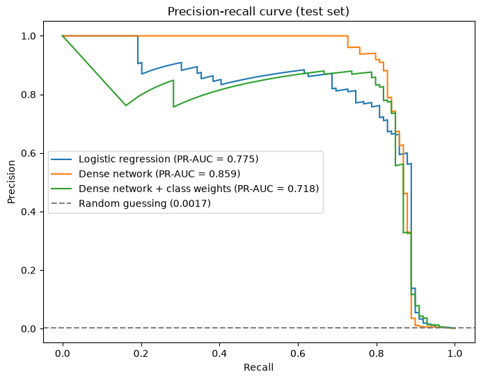

# Credit card fraud detection

I trained models to spot fraudulent card transactions in the Kaggle credit card fraud dataset, where only 0.173% of transactions are fraud. I compared a logistic regression baseline with a small Keras dense network, trained once plainly and once with class weights, and picked each model's decision threshold on a validation set. Everything is in one notebook using TensorFlow/Keras and scikit-learn.



## How it works

1. Download the dataset with `kagglehub` (284,807 transactions, 492 of them fraud). The features are `Time`, `Amount` and 28 PCA components `V1` to `V28`.
2. Plot the class imbalance on a normal and a log scale, and compare `Amount` and `Time` for normal and fraud transactions.
3. Split 60/20/20 into train, validation and test sets, stratified on the label so each split keeps the same fraud rate (295, 98 and 99 fraud cases).
4. Scale `Time` and `Amount` with `StandardScaler`, fitted on the training set only. The PCA columns are left as they are.
5. Train three models:
   - scikit-learn `LogisticRegression`
   - a Keras `Sequential` network with dense layers of 32 and 16 units (ReLU) and a sigmoid output, the same shape as the predictor in my Adaptive-Alpha-Control project
   - the same network trained with balanced class weights (about 0.5 for normal and 290 for fraud)
   
   Both networks use Adam (learning rate 0.001), binary cross-entropy, batch size 256, up to 30 epochs, and early stopping on validation PR-AUC with the best weights restored.
6. For each model, choose the threshold that gives the highest F1 on the validation set. The test set is only used for the final evaluation.
7. Report accuracy, precision, recall, F1 and PR-AUC on the test set, with confusion matrices and precision-recall curves.

## Results

All figures are on the test set (56,962 transactions, 99 fraud). PR-AUC is average precision and does not depend on the threshold.

| Model | Threshold | Accuracy | Precision | Recall | F1 | PR-AUC |
|---|---|---|---|---|---|---|
| Logistic regression | 0.5 | 0.9993 | 0.8701 | 0.6768 | 0.7614 | 0.7755 |
| Logistic regression | 0.1003 (tuned) | 0.9992 | 0.7647 | 0.7879 | 0.7761 | 0.7755 |
| Dense network | 0.5 | 0.9996 | 0.9405 | 0.7980 | 0.8634 | 0.8593 |
| Dense network | 0.6274 (tuned) | 0.9995 | 0.9390 | 0.7778 | 0.8508 | 0.8593 |
| Dense network with class weights | 0.5 | 0.9817 | 0.0795 | 0.8990 | 0.1461 | 0.7184 |
| Dense network with class weights | 0.9774 (tuned) | 0.9994 | 0.8495 | 0.7980 | 0.8229 | 0.7184 |

Accuracy is close to useless here. Predicting "normal" for every transaction already scores 99.83% accuracy with zero recall, and the weighted network at 0.5 still scores 98.2% while only about 8% of its fraud alerts are real.

The plain dense network was the best model. At its tuned threshold it caught 77 of the 99 fraud cases with only 5 false alarms out of 56,863 normal transactions. Class weights raised recall at the default threshold to 89.9%, but precision collapsed and the overall PR-AUC was the lowest of the three. Its validation PR-AUC peaked after 2 epochs, so a weight of about 290 makes it overfit the few fraud examples quickly.

Tuning the threshold on the validation set rescued the weighted network (F1 from 0.146 to 0.823) and helped logistic regression a little. For the plain network the tuned threshold did slightly worse on the test set than 0.5, which shows how noisy a threshold picked from 98 validation fraud cases can be.

## Repository layout

| Path | What it is |
|---|---|
| `fraud_detection.ipynb` | Data exploration, the three models, threshold tuning and evaluation |
| `pr_curve.png` | Test set precision-recall curves saved from the notebook |
| `requirements.txt` | Python packages the notebook imports |

## Running it

```
pip install -r requirements.txt
jupyter notebook fraud_detection.ipynb
```

The notebook downloads the [credit card fraud dataset](https://www.kaggle.com/datasets/mlg-ulb/creditcardfraud) with `kagglehub`, so the CSV is not in the repo. The whole notebook ran in under a minute on an M1 MacBook CPU. On my Mac, importing pandas before TensorFlow made the first `fit` call hang, so TensorFlow is imported first.

## Limitations

The dataset covers two days of transactions from 2013 and the features are anonymised PCA components, so I could not look at which real features matter. The test set only has 99 fraud cases, so one or two more caught or missed changes recall by one to two points. The threshold is chosen by F1, which treats a missed fraud and a false alarm as equally bad, and a real bank would weigh these differently.

This was written by AI for learning practice.
